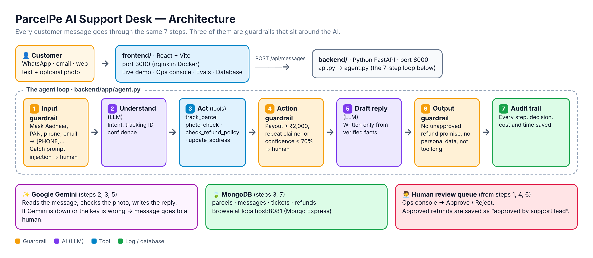

# ParcelPe AI Support Desk

A Forward Deployed Engineering case study: an AI agent that answers ParcelPe's customer messages safely, with guardrails, a human review queue, evals and a full MongoDB audit trail.



## Run it (simplest)

```bash
bash start.sh       # opens http://localhost:8000 — only Python 3 needed
```
The 5 demo cases: **[RUN_DEMO.md](RUN_DEMO.md)**

## Run it with Docker + MongoDB

```bash
cp .env.example .env          # add GEMINI_API_KEY, or keep LLM_PROVIDER=mock
docker compose up --build
```

| Open | For |
|---|---|
| http://localhost:3000 | The app (Live demo · Ops console · Evals · Database) |
| http://localhost:8000/docs | API |
| http://localhost:8081 | Browse MongoDB |

Full setup (with and without Docker, MongoDB options, Gemini key, troubleshooting): **[SETUP.md](SETUP.md)**
What to say on stage: **[DEMO_GUIDE.md](DEMO_GUIDE.md)**

## The FDE steps, in this repo
| Step | Where |
|---|---|
| 1. Audit | `docs/01_audit.md` |
| 2. Build + evals | `backend/`, `frontend/`, `backend/evals/`, `docs/02_solution_design.md` |
| 3. Deploy + monitor | `docker-compose.yml`, `docs/03_deployment_plan.md`, Ops console |
